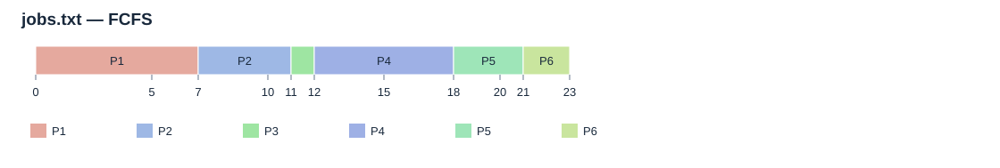
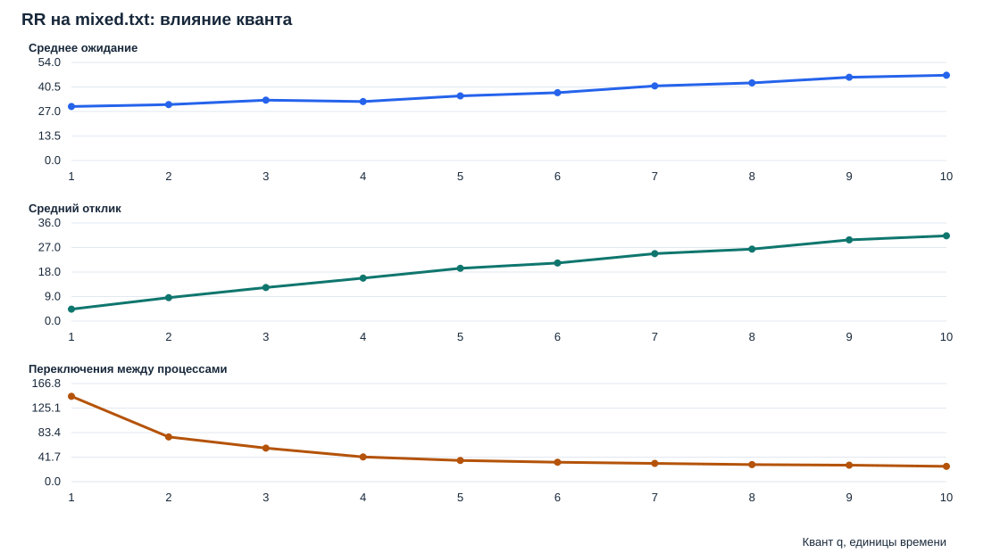

# Проект 1. Планировщик учебного сервера

Программа моделирует, как один процессор выполняет несколько поступающих задач. На одних и тех же данных сравниваются FCFS, SJF, RR, SRTF, Priority и MLFQ. Цель — уменьшить задержки коротких запросов и обеспечить выполнение длинных задач.

Выполнены программные части блоков **А, Б и В**. В этом README собраны участники, команды запуска, объяснения алгоритмов, фактические таблицы, выводы и сведения о проверке. Фото диаграммы, нарисованной на бумаге, пока не добавлено.

## 1. Участники команды

| Участник | Уровень / роль | Ответственность |
| --- | --- | --- |
| Кашымбеков Актан | В | Голодание, старение приоритетов, MLFQ, сборка и сверка с ПР-5 |
| Осмонов Медер | А | FCFS, SJF, RR q=2, ручной расчёт для jobs.txt |
| Адылов Арсен | Б | SRTF, вытесняющий Priority и метрики |
| Кабылбеков Айжигит | Б | Эксперимент RR q=1…10, сравнительные таблицы и рекомендации |
| Гулчороева Асема | Презентация | Слайды по расчётам, диаграммам и выводам |

Ответственные также указаны комментариями в начале собственных файлов программы. Код алгоритмов: Медер, Арсен и Актан; отчёт и таблицы: Айжигит и Актан; сборка: Актан. Файлы в `project1/reference/pr5` — неизменённый внешний снимок для сверки.

## 2. Как запустить всё сразу на Windows

Требуется **Python 3.11 или новее**. Дополнительные библиотеки и подключение к интернету не нужны.

Самый простой способ:

1. Открыть папку `modul1` в Проводнике.
2. Дважды нажать **`run_windows.bat`**.
3. Дождаться сообщения `All checks passed`.
4. Открыть **`project1/results/report.html`** — это готовый отчёт с таблицами и диаграммами.

Через PowerShell — из папки `modul1`:

```powershell
python run_all.py
```

Например, для подготовленной локальной папки:

```powershell
cd C:\Users\lulu\Documents\Projects\os_module\modul1
python run_all.py
```

Если репозиторий скачан в другое место, сначала перейдите в его папку `modul1`. Из корня репозитория можно выполнить `python modul1/run_all.py`.

Одна команда выполняет последовательно:

1. Расчёты всех блоков А, Б, В, построение отчёта, таблиц и диаграмм; в том числе сверку с опубликованной ПР-5.
2. Все 13 собственных тестов.

Полный текст команд и их вывода сохраняется в **`logs/windows.txt`**. При ошибке запуск останавливается с ненулевым кодом; сообщение и подробности остаются в том же файле. README при запуске не перезаписывается.

## 3. Запуск на Ubuntu / WSL

Из папки `modul1` достаточно одной команды:

```bash
python3 run_all.py
```

Для уже подготовленной Windows-папки в терминале Ubuntu:

```bash
cd /mnt/c/Users/lulu/Documents/Projects/os_module/modul1
python3 run_all.py
```

В чистой Ubuntu нужен Python 3.11+. Скрипт использует только стандартную библиотеку: установка пакетов через pip не требуется. Фактический контроль выполнялся на установленной Ubuntu через WSL2, а не на отдельной свежей виртуальной машине. Вывод Linux-запуска сохраняется в **`logs/ubuntu.txt`**.

## 4. Как запускать алгоритмы по очереди

**Все следующие команды выполняются из папки `modul1`.** На Windows используйте `python`, на Ubuntu — `python3`.

### Блок А: FCFS, SJF и RR с квантом 2

```powershell
python project1/run.py simulate --input project1/jobs.txt --algorithm FCFS
python project1/run.py simulate --input project1/jobs.txt --algorithm SJF
python project1/run.py simulate --input project1/jobs.txt --algorithm RR --quantum 2
```

### Блок Б: SRTF, Priority и смешанная нагрузка

```powershell
python project1/run.py simulate --input project1/mixed.txt --algorithm FCFS
python project1/run.py simulate --input project1/mixed.txt --algorithm SJF
python project1/run.py simulate --input project1/mixed.txt --algorithm RR --quantum 2
python project1/run.py simulate --input project1/mixed.txt --algorithm SRTF
python project1/run.py simulate --input project1/mixed.txt --algorithm PRIORITY
```

Проверить другой квант RR, например 5:

```powershell
python project1/run.py simulate --input project1/mixed.txt --algorithm RR --quantum 5
```

Все кванты 1…10 в PowerShell:

```powershell
1..10 | ForEach-Object { python project1/run.py simulate --input project1/mixed.txt --algorithm RR --quantum $_ }
```

### Блок В: голодание, старение и MLFQ

```powershell
python project1/run.py simulate --input project1/starve.txt --algorithm PRIORITY
python project1/run.py simulate --input project1/starve.txt --algorithm PRIORITY --aging-interval 3
python project1/run.py simulate --input project1/mixed.txt --algorithm MLFQ --mlfq-quanta 2 4 8 --boost-interval 20
```

Отдельный запуск показывает в терминале таблицу каждого процесса, средние значения и последовательность выполнения. Для сохранения CSV одного запуска добавьте `--output-dir`, например:

```powershell
python project1/run.py simulate --input project1/jobs.txt --algorithm FCFS --output-dir my_result
```

Только пересоздать полный отчёт, без запуска тестов:

```powershell
python project1/run.py
```

Изменить параметры полного отчёта:

```powershell
python project1/run.py report --aging-interval 3 --mlfq-quanta 2 4 8 --boost-interval 20
```

Таблицы ниже относятся к стандартным параметрам: RR q=2, старение каждые 3 единицы, MLFQ 2/4/8 с boost каждые 20 единиц. Если менять параметры, актуальные числа нужно брать из нового HTML-отчёта и CSV.

## 5. Файлы и результаты

```text
modul1/
├── README.md                  — вся инструкция и выводы
├── run_windows.bat            — запуск двойным щелчком на Windows
├── run_all.py                 — полный запуск на Windows и Ubuntu
├── logs/
│   ├── windows.txt            — фактический вывод Windows
│   └── ubuntu.txt             — фактический вывод Ubuntu/WSL
└── project1/
    ├── scheduler.py           — алгоритмы и метрики
    ├── run.py                 — запуск одного алгоритма или отчёта
    ├── reporting.py           — таблицы, HTML и SVG
    ├── test_scheduler.py      — 13 тестов
    ├── verify_pr5.py          — внешняя сверка ПР-5
    ├── set1.txt               — контрольные 4 процесса
    ├── jobs.txt               — основные 6 процессов
    ├── mixed.txt              — 3 длинных и 15 коротких задач
    ├── starve.txt             — 20 процессов для голодания
    ├── assets/                — место для фотографии
    ├── reference/             — снимок ПР-5 и его контрольные суммы
    └── results/               — отчёт, общие CSV и диаграммы
```

В папке результатов:

| Файл | Содержимое |
| --- | --- |
| [report.html](project1/results/report.html) | Главный оформленный отчёт; открыть браузером, при необходимости распечатать |
| [summary.csv](project1/results/summary.csv) | Средние метрики и переключения для всех наборов и вариантов |
| [metrics.csv](project1/results/metrics.csv) | Подробные метрики каждого процесса; первые столбцы — набор и алгоритм |
| [timeline.csv](project1/results/timeline.csv) | Интервалы выполнения каждого варианта, также с набором и алгоритмом |
| [rr_quantums.csv](project1/results/rr_quantums.csv) | Сравнение RR q=1…10 на mixed.txt |
| `*.svg` | Готовые диаграммы и графики для презентации |
| `pr5_verification.json`, `pr5_*_checks.csv` | Подтверждение внешней сверки |
| `manifest.json` | Параметры расчёта и SHA-256 исходных файлов |

CSV используют запятую как разделитель и UTF-8 с BOM. В них значения сохраняются без округления; в README и отчёте средние показаны с двумя знаками. При импорте в Excel нужно выбрать разделитель «запятая».

## 6. Входные данные и метрики

Формат каждой строки:

```text
PID arrival burst priority
P1 0 7 3
```

- `PID` — имя процесса.
- `arrival` — момент поступления в систему.
- `burst` — требуемое процессу время CPU.
- `priority` — приоритет: **меньшее число означает более высокий приоритет**.

Комментарии начинаются с `#`. Все времена целые, `arrival ≥ 0`, `burst > 0`; PID уникальны. Программа проверяет эти условия.

| Показатель | Формула | Значение |
| --- | --- | --- |
| Оборот T | completion − arrival | От поступления до завершения |
| Ожидание W | T − burst | Всё время в очереди, включая паузы после вытеснения |
| Отклик R | first_start − arrival | До первого получения процессора |

Модель: один CPU, без ввода-вывода, стоимость переключения равна нулю. При равенстве ключей учитываются приход и порядок строк. SRTF и Priority сохраняют CPU текущему процессу при равенстве ключа. В RR поступления на границе кванта входят в очередь раньше возвращаемого процесса. Переключением считается прямой переход между разными PID; первый запуск, переход через простой и повторный квант того же PID не учитываются.

## 7. Блок А: базовые алгоритмы и ручной расчёт

FCFS выполняет готовые процессы по приходу. SJF после завершения текущей задачи выбирает самую короткую из готовых. RR выдаёт CPU по очереди не более чем на один квант; незавершённая задача возвращается в конец очереди.

### Диаграмма FCFS для jobs.txt

```text
0–7 P1 | 7–11 P2 | 11–12 P3 | 12–18 P4 | 18–21 P5 | 21–23 P6
```



| PID | Приход | CPU | Начало | Завершение | Ожидание | Оборот |
| --- | --- | --- | --- | --- | --- | --- |
| P1 | 0 | 7 | 0 | 7 | 0 | 7 |
| P2 | 2 | 4 | 7 | 11 | 5 | 9 |
| P3 | 3 | 1 | 11 | 12 | 8 | 9 |
| P4 | 5 | 6 | 12 | 18 | 7 | 13 |
| P5 | 6 | 3 | 18 | 21 | 12 | 15 |
| P6 | 8 | 2 | 21 | 23 | 13 | 15 |

Ручной расчёт: начало следующего процесса равно `max(arrival, завершение предыдущего)`. Для P2: начало `max(2, 7) = 7`, завершение `7 + 4 = 11`, ожидание `7 − 2 = 5`, оборот `11 − 2 = 9`.

Среднее ожидание: `(0 + 5 + 8 + 7 + 12 + 13) / 6 = 7,50`. Средний оборот: `(7 + 9 + 9 + 13 + 15 + 15) / 6 ≈ 11,33`.

### Сравнение jobs.txt

Первые три строки относятся к блоку А; SRTF и Priority добавлены в блоке Б.

| Алгоритм | Среднее ожидание | Средний оборот | Средний отклик | Переключения |
| --- | --- | --- | --- | --- |
| FCFS | 7,50 | 11,33 | 7,50 | 5 |
| SJF | 5,17 | 9,00 | 5,17 | 5 |
| RR q=2 | 8,33 | 12,17 | 3,17 | 12 |
| SRTF | 4,33 | 8,17 | 2,50 | 7 |
| Priority | 7,50 | 11,33 | 5,17 | 7 |

**Вывод блока А:** среди трёх базовых алгоритмов SJF даёт минимальные средние ожидание и оборот. RR q=2 обеспечивает более ранний первый отклик, но увеличивает ожидание. Выбор зависит от важной для заказчика метрики.

### Контрольный set1.txt

| Алгоритм | Среднее ожидание | Средний оборот | Средний отклик |
| --- | --- | --- | --- |
| FCFS | 8,75 | 15,25 | 8,75 |
| SJF | 7,75 | 14,25 | 7,75 |
| SRTF | 6,50 | 13,00 | 4,25 |
| RR q=2 | 12,75 | 19,25 | 2,00 |

Результаты проверены ручными примерами в тестах и сопоставлением с опубликованной ПР-5. Особенности кванта и приоритетов источника описаны в разделе 10.

## 8. Блок Б: пять алгоритмов и выбор кванта RR

SRTF каждый такт выбирает задачу с наименьшим оставшимся временем и может вытеснить текущую. Вытесняющий Priority выбирает наивысший приоритет; при поступлении задачи со строго лучшим приоритетом текущая приостанавливается.

### Пять алгоритмов на mixed.txt

В файле 18 процессов: три длинные задачи и 15 коротких. Короткими здесь считаются `burst ≤ 4`.

| Алгоритм | Среднее ожидание | Средний оборот | Средний отклик | Переключения |
| --- | --- | --- | --- | --- |
| FCFS | 93,28 | 102,00 | 93,28 | 17 |
| SJF | 32,67 | 41,39 | 32,67 | 17 |
| RR q=2 | 30,83 | 39,56 | 8,61 | 76 |
| SRTF | 12,28 | 21,00 | 6,33 | 23 |
| Priority | 13,00 | 21,72 | 10,83 | 24 |

SRTF имеет минимальные средние ожидание и оборот на этом наборе. Средний отклик только коротких запросов у него равен **0,47**, тогда как у RR q=2 — **9,93**. Общая средняя отклика включает также поздние первые старты длинных задач, поэтому для интерактивных запросов важно смотреть отдельную группу.

### RR: кванты 1…10 на mixed.txt

| Квант | Среднее ожидание | Средний отклик | Переключения |
| --- | --- | --- | --- |
| 1 | 29,78 | 4,39 | 145 |
| 2 | 30,83 | 8,61 | 76 |
| 3 | 33,28 | 12,33 | 57 |
| 4 | 32,50 | 15,78 | 42 |
| 5 | 35,61 | 19,39 | 36 |
| 6 | 37,39 | 21,33 | 33 |
| 7 | 41,11 | 24,78 | 31 |
| 8 | 42,78 | 26,44 | 29 |
| 9 | 45,89 | 29,83 | 28 |
| 10 | 47,00 | 31,33 | 26 |



**Рекомендация:** если длительности задач известны заранее, для данного mixed.txt предпочтителен SRTF. Если выбирать RR, q=1 даёт лучшие в этом опыте ожидание и отклик, но вызывает 145 переключений. q=2 уменьшает их до 76 — на **47,6%** — с ухудшением отклика до 8,61. Поэтому q=2 можно рассматривать как компромисс по числу переключений. Стоимость переключений не моделируется, универсальный оптимальный квант этим экспериментом не установлен.

## 9. Блок В: голодание, старение и MLFQ

### Голодание P1 при Priority

P1 в starve.txt имеет низкий приоритет 9. Остальные процессы с лучшими приоритетами поддерживают непрерывную очередь работы до момента 57.

| Режим | Первый старт P1 | Завершение P1 | Ожидание P1 | Оборот P1 |
| --- | --- | --- | --- | --- |
| Priority без старения | 57 | 63 | 57 | 63 |
| Priority со старением каждые 3 единицы | 21 | 27 | 21 | 27 |

Старение вычисляется так:

```text
накопленное ожидание = текущее время − arrival − уже выполненное CPU-время
эффективный приоритет = исходный приоритет − floor(накопленное ожидание / 3)
```

Во время выполнения ожидание не растёт. Накопленное улучшение не сбрасывается после получения CPU; приоритет снизу не ограничен. При строгом улучшении возможно вытеснение.

**Результат:** P1 стартует и заканчивает работу на **36 единиц раньше**. На конечном файле он завершается и без старения; пример показывает механизм голодания. При бесконечном потоке более приоритетных задач без старения ожидание могло бы стать неограниченным.

### Устройство MLFQ

Используются три очереди: Q0 с квантом **2**, Q1 — **4**, Q2 — **8**. Новая задача поступает в Q0. Планировщик берёт задачу из самой высокой непустой очереди; внутри каждой действует FIFO.

Исчерпав квант, задача понижается на уровень; из Q2 возвращается в Q2. При поступлении задачи более высокого уровня текущая вытесняется, сохраняя остаток кванта и место в начале своей очереди. Каждые **20** единиц выполняется boost: все поступившие незавершённые задачи поднимаются в Q0, бюджеты квантов сбрасываются. Работающая задача продолжает свой ход; ожидающие идут по прежним уровням сверху вниз и FIFO внутри уровня.

При одновременных событиях порядок такой: поступления → возврат после кванта → boost → выбор задачи.

### MLFQ против SRTF и RR на mixed.txt

| Алгоритм | Среднее ожидание | Средний оборот | Средний отклик | Переключения |
| --- | --- | --- | --- | --- |
| SRTF | 12,28 | 21,00 | 6,33 | 23 |
| RR q=2 | 30,83 | 39,56 | 8,61 | 76 |
| MLFQ 2/4/8, boost=20 | 24,89 | 33,61 | 3,50 | 62 |

MLFQ даёт меньший общий средний отклик, чем RR q=2, и меньше переключений. Отклик коротких запросов MLFQ — **4,07**. Все три длинные задачи завершаются. Параметры проверены на данном наборе; их оптимальность при произвольной нагрузке не доказана.

**Почему MLFQ не требуется заранее знать длительность:** выбор очереди зависит от того, израсходовала ли задача квант, её уровня, остатка бюджета и наступления boost. Полная длительность не используется для ранжирования. Симулятор хранит remaining, чтобы определить момент завершения, — это аналог сигнала о завершении процесса от системы.

**Вывод блока В:** при неизвестных длительностях разумно использовать проверенную конфигурацию MLFQ с периодическим boost. Она быстро допускает новые короткие задачи к CPU и возвращает длительные в верхнюю очередь.

## 10. Проверки и сверка с ПР-5

Проверка всего проекта: `python run_all.py` из папки modul1.

Отдельные тесты:

```powershell
python -m unittest discover -s project1 -p test_scheduler.py -v
python project1/verify_pr5.py
```

Фактически проверены Windows / Python **3.14.3** и Ubuntu WSL2 / Python **3.14.4**. В обеих средах прошли **13 тестов**. Среди них ручные расписания, граничные поступления RR, равенство ключей, простой CPU, старение, уровни/вытеснение/boost MLFQ и проверка входа. Один из тестов дополнительно прогоняет 60 случайных наборов через 7 вариантов — **420 симуляций** — и проверяет CPU-время и метрики каждого процесса.

Источник внешней сверки: [ПР-5 в operation_system_practice_tasks](https://github.com/aktan228/operation_system_practice_tasks/tree/07f7b4bf1721ca904d997848e9c2a885a70abfcf/pr5), commit `07f7b4bf1721ca904d997848e9c2a885a70abfcf`. Снимок 9 файлов и их Git blob SHA сохранены в `project1/reference`; сеть для повторной сверки не нужна.

Совпали **5 опубликованных результатов** и **64 полных расписания**: четыре набора × FCFS/SJF/SRTF/Priority, Priority aging=2 и 3, RR q=1…10. При сравнении соседние интервалы одного PID объединяются; обозначение простоя приводится к одному виду.

Особенности источника:

- Опубликованный RR использует **q=3**: ожидание 13,50, оборот 20,00, отклик 3,00. В проекте основной RR — **q=2**. Оба варианта проверены отдельно.
- У set1 одинаковые arrival/burst, но приоритеты проекта `[2,3,1,4]` отличаются от ПР-5 `[3,1,4,2]`. Опубликованный Priority проверен на копии входа репозитория; исходные данные проекта сохранены.
- Полный внешний `sched.py` содержит синтаксическую ошибку в строке 149. Для 64 сравнений использована просмотренная неизменённая часть с функцией simulate до функции metrics. Полный внешний CLI и его тесты успешно запущенными не объявляются; пять сохранённых результатов проверены отдельно.
- README ПР-5 сообщает о противоречии FCFS в исходном условии. Наш ручной расчёт и опубликованная диаграмма дают **8,75 / 15,25**. Оригинал преподавательского условия отдельно не предоставлен.
- MLFQ отсутствует в ПР-5 и проверяется собственными тестами проекта.

## 11. Фото ручной диаграммы

По условию блока А диаграмму FCFS и расчёты из раздела 7 нужно выполнить **на бумаге**. Электронный SVG служит образцом; фото бумажной работы пока нет.

1. Перерисовать диаграмму и таблицу из раздела 7, записать средние.
2. Сфотографировать лист и сохранить настоящий JPG в `project1/assets/fcfs_jobs_handwritten.jpg`.
3. Добавить в этот README строку вне блока кода:

```markdown

```

После добавления фото его нужно включить в следующий коммит.

## 12. Что показать и объяснить на защите

1. Запустить всё одной командой и открыть `project1/results/report.html`.
2. Показать FCFS и объяснить расчёт ожидания и оборота одного процесса.
3. Сравнить пять алгоритмов на mixed.txt: объяснить, почему SJF не останавливает уже начатую длинную задачу, а SRTF останавливает.
4. По таблице RR показать компромисс: малый квант улучшает отклик, но увеличивает переключения.
5. Показать старт P1 в моменты 57 и 21, объяснить старение.
6. Объяснить три очереди MLFQ и периодический boost; назвать ограничение SRTF — необходимость знать длительность заранее.

Для презентации используйте таблицы этого README, CSV с точными числами и SVG из `project1/results`. Главный вывод: **SRTF выигрывает по ожиданию на изученной нагрузке при известных длительностях; MLFQ подходит для неизвестных длительностей; RR требует выбора компромиссного кванта.**

Репозиторий сдачи: [aktan228/os_practice_module](https://github.com/aktan228/os_practice_module). В этой папке выполнен проект 1. Проекты 2–4 в состав этой сдачи не входят.
