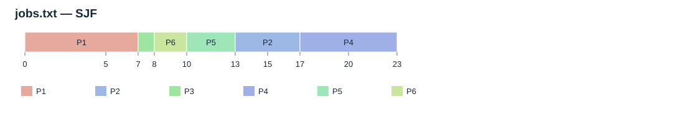
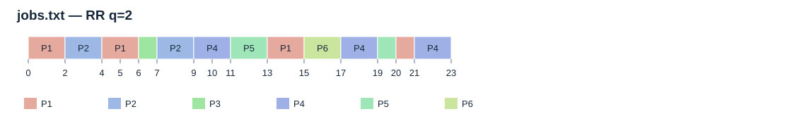
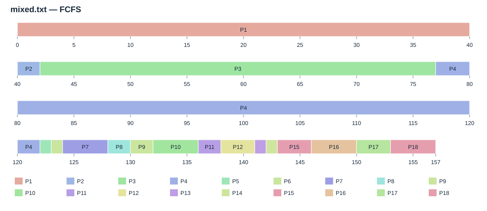
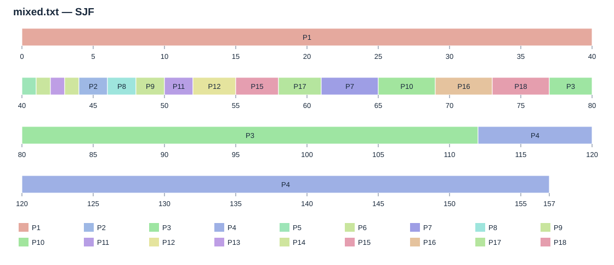
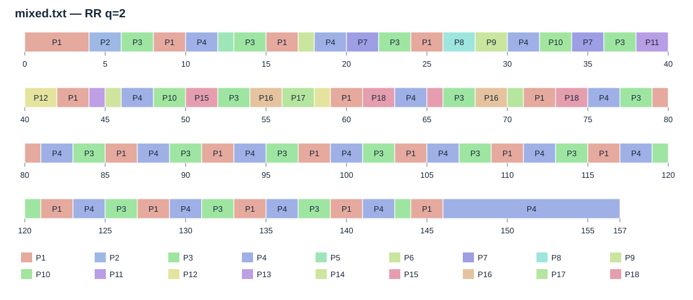
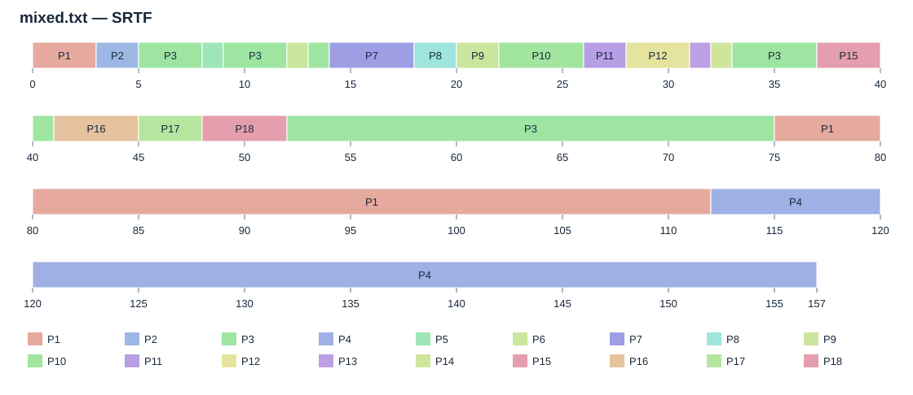
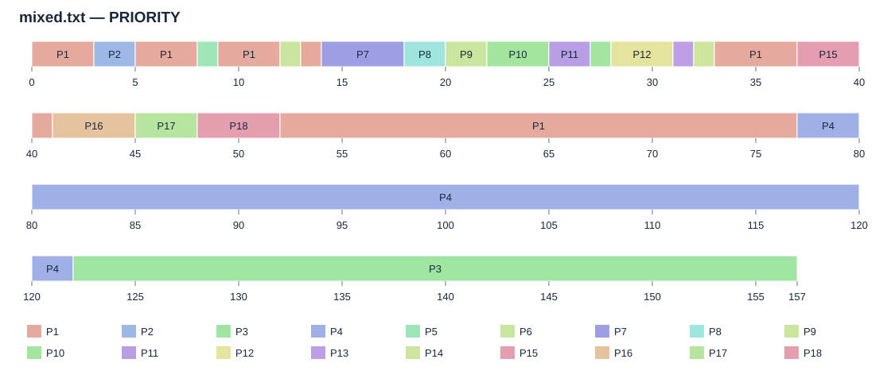
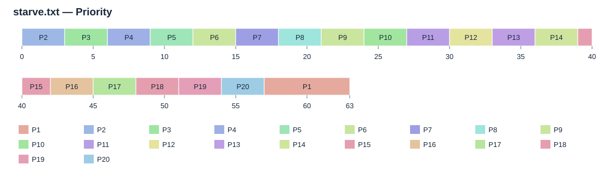
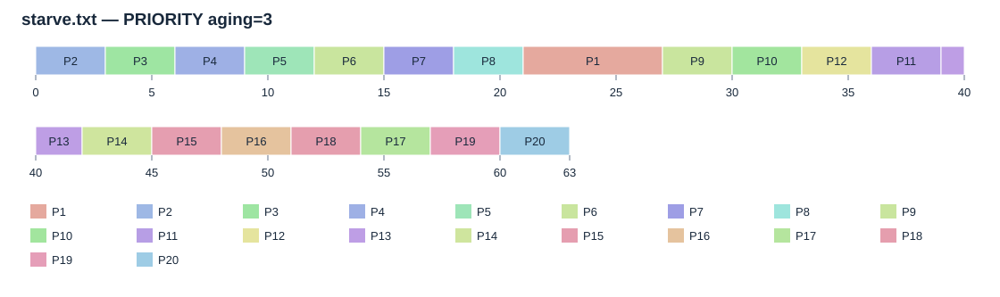
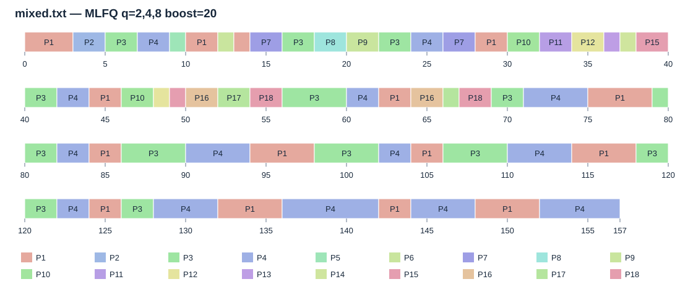

Команда и распределение ответственности: [TEAM.md](../TEAM.md). Подготовка презентации — Гулчороева Асема.

# Практики А, Б и В: планировщик учебного сервера

Реализация проекта 1 на Python 3.11+ без сторонних библиотек. Работает в Windows, Ubuntu и WSL2. Ниже команд и описания файлов приведён полный отчёт с фактическими таблицами, диаграммами и выводами. README и отчёт пересоздаются командой запуска; исходные `.txt` не изменяются.

## Выполненные практики

| Блок | Что реализовано | Где смотреть |
| --- | --- | --- |
| А1 | FCFS для jobs.txt, диаграмма Ганта, расчёт ожидания и оборота каждого PID | Раздел А1 ниже, `results/jobs_fcfs_metrics.csv` |
| А2 | FCFS, невытесняющий SJF, RR с квантом 2 | `scheduler.py`, таблица А2–А4 |
| А3 | Ручной контроль set1 и внешняя сверка с ПР-5: 5 опубликованных результатов и 64 расписания | Раздел А3, `verify_pr5.py`, `results/pr5_verification.json` |
| А4 | Сравнение среднего ожидания и оборота на jobs.txt, обоснование выбора | Таблица и выводы А2–А4 |
| Б1 | Вытесняющие SRTF и Priority, ожидание, оборот и отклик | Таблица Б1, CSV для каждого процесса |
| Б2 | Все пять алгоритмов на mixed.txt | Таблица Б2 |
| Б3 | RR для квантов от 1 до 10, ожидание, отклик, переключения | Таблица Б3, `results/rr_quantums.csv`, графики |
| Б4 | Рекомендация алгоритма и кванта на основании чисел | Раздел Б4 |
| В1 | Голодание P1 при Priority на starve.txt | Раздел В1–В2, диаграммы |
| В2 | Старение приоритетов и измерение улучшения для P1 | Раздел В1–В2 |
| В3 | MLFQ: три очереди, растущие кванты, понижение, boost; сравнение с SRTF и RR | Раздел В3 |
| В4 | Объяснение работы MLFQ без предварительного знания длительности | Раздел В4 |

**Сверка с указанным репозиторием ПР-5 выполнена:** 5/5 опубликованных результатов и 64/64 сопоставления расписаний совпали. Проверены правила равенства, очередь RR, старение и подсчёт переключений. Источник зафиксирован по commit; снимок и результаты лежат в `reference` и `results`. При сверке учтены разные кванты RR и разные приоритеты set1. Подробности и обнаруженная синтаксическая ошибка внешнего `sched.py` описаны в разделе А3 ниже.

**Фото выполненной на бумаге диаграммы ещё не добавлено.** Фото сохраните в `assets/fcfs_jobs_handwritten.jpg` и повторите запуск — README автоматически включит его. Оригинал преподавательского условия/эталона не представлен в репозитории: подтверждена сверка с опубликованной ПР-5, а не с недоступным оригиналом. Если имя фото другое, добавьте строку самостоятельно:

```markdown

```

## Команды запуска

Windows PowerShell — из папки проекта:

```powershell
cd C:\Users\lulu\Documents\Projects\os_module\project1
python run.py
python -m unittest -v test_scheduler
python verify_pr5.py
```

Ubuntu / WSL2:

```bash
cd /mnt/c/Users/lulu/Documents/Projects/os_module/project1
python3 run.py
python3 -m unittest -v test_scheduler
python3 verify_pr5.py
```

Один алгоритм, конкретный набор и параметры:

```powershell
python run.py simulate --input jobs.txt --algorithm FCFS
python run.py simulate --input jobs.txt --algorithm SJF
python run.py simulate --input jobs.txt --algorithm RR --quantum 2
python run.py simulate --input mixed.txt --algorithm SRTF
python run.py simulate --input starve.txt --algorithm PRIORITY
python run.py simulate --input starve.txt --algorithm PRIORITY --aging-interval 3
python run.py simulate --input mixed.txt --algorithm MLFQ --mlfq-quanta 2 4 8 --boost-interval 20
```

Полный отчёт с изменёнными параметрами старения и MLFQ:

```powershell
python run.py report --aging-interval 3 --mlfq-quanta 2 4 8 --boost-interval 20
```

У `report` есть `--input-dir` и `--output-dir`. У `simulate` параметр `--output-dir` сохраняет CSV одного запуска. Изменение параметров полного отчёта обновляет таблицы, диаграммы и этот README. Чтобы сохранить свои дополнения, пишите их в отдельном файле либо в `GUIDE.md`, текст которого включается в начало README.

## Файлы проекта

| Файл | Назначение |
| --- | --- |
| `scheduler.py` | Модель процессов, чтение и проверка входа, шесть алгоритмов, метрики |
| `run.py` | Командная строка, отдельный запуск и генерация полного отчёта |
| `reporting.py` | Расчёты блоков, отчёт, CSV и SVG без внешних зависимостей |
| `test_scheduler.py` | Ручные контрольные примеры, события на границах, старение и MLFQ, инварианты на случайных наборах |
| `verify_pr5.py` | Сверка опубликованных метрик и расписаний с зафиксированным снимком ПР-5 |
| `reference/SOURCE.json` | Адрес источника, commit и Git blob SHA всех 9 файлов снимка |
| `reference/pr5/` | Точные копии источников и опубликованных результатов ПР-5 |
| `results/pr5_verification.json` | Результат внешней сверки, различия наборов и ограничения проверки |
| `results/pr5_*_checks.csv` | Все 5 проверок опубликованных результатов и 64 сравнения расписаний |
| `GUIDE.md` | Сохраняемая вводная часть README |
| `README.md` | Команды, полный отчёт, таблицы и выводы для презентации |
| `results/report.html` | Автономный оформленный отчёт: открывается браузером, есть кнопка печати |
| `results/report.md` | Текст расчётного отчёта отдельно от инструкции |
| `results/*_metrics.csv` | Метрики каждого процесса |
| `results/*_timeline.csv` | Полная последовательность интервалов выполнения |
| `results/rr_quantums.csv` | Результаты RR для квантов 1…10 |
| `results/*.svg` | Диаграммы и графики для вставки в презентацию |
| `results/manifest.json` | SHA-256 исходных данных и параметры расчёта |

CSV сохранены в UTF-8 с BOM, разделитель — запятая; числовые значения не округлены. В таблицах отчёта показаны два знака после запятой. Для импорта в Excel укажите разделитель «запятая». Столбцы start/completion/waiting/turnaround/response означают первый старт/завершение/ожидание/оборот/отклик. PID выводятся в исходном порядке файла, а не в порядке завершения.

## Проверка реализации

13 тестов включают независимые ручные расписания для FCFS, SJF, RR, SRTF и Priority; поступление точно на границе кванта; сохранение работы при равенстве ключей; простой; понижение, вытеснение и boost в MLFQ; старение на исходном starve.txt; ошибки входных данных. Дополнительно 60 случайных наборов прогоняются через 7 вариантов планирования (420 симуляций), проверяется сохранение CPU-времени каждого PID, отсутствие работы до поступления, отсутствие простоя при готовой задаче и согласованность метрик с диаграммой. Отдельная команда `python verify_pr5.py` подтверждает совпадение с опубликованной ПР-5: 5 результатов и 64 расписания. Каждый полный запуск отчёта повторяет эту внешнюю сверку, используя локальный снимок; интернет не требуется.

## Как использовать материал в презентации

1. Постановка: короткие запросы должны быстро получать CPU, длинные задачи должны завершаться.
2. Модель и метрики: один CPU, условное время, ожидание, оборот, отклик.
3. Блок А: FCFS на бумаге, три базовых алгоритма, проверка set1.
4. Блок Б: пять алгоритмов на смешанной нагрузке; влияние кванта RR; рекомендация с числами.
5. Блок В: задержка P1 и старение; устройство MLFQ и сравнение с SRTF/RR.
6. Выводы и ограничения: известность burst, цена переключений, конечность потока; результат сверки с ПР-5 и отличие опубликованного отчёта от оригинала условия.

Все числа и готовые изображения для этих слайдов приведены ниже. Для копирования используйте SVG из `results`, а для собственного оформления таблиц — соответствующие CSV. Фактический отчёт относится к исходным файлам с контрольными суммами в manifest.json.


---

# Проект 1. Планировщик учебного сервера — блоки А, Б и В

Расчёты выполнены на исходных set1.txt, jobs.txt, mixed.txt и starve.txt. Программа моделирует один процессор; все времена — условные целые единицы. Стоимость переключения равна нулю. Исходные данные не изменяются.

## Модель, формулы и правила

arrival — время поступления; burst — требуемое время CPU; start — первое выполнение; completion — завершение. Оборот T = completion − arrival. Ожидание W = T − burst. Отклик R = start − arrival. Ожидание включает все паузы после вытеснения. Средние берутся по всем процессам, без округления промежуточных значений.

Меньшее число означает более высокий приоритет. При равенстве ключей выбирается более раннее поступление, затем порядок строк в файле. При равенстве оставшегося времени или приоритета работающий процесс не вытесняется. SJF невытесняющий; SRTF и Priority вытесняющие. В RR новые поступления в момент окончания кванта помещаются в очередь перед возвращаемым процессом; ожидающие сохраняют FIFO-порядок.

Переключение — непосредственный переход от одного PID к другому. Первый запуск, переходы через простой и повторная выдача CPU тому же PID не считаются переключениями. Число выдач CPU (dispatches) отдельно записано в rr_quantums.csv. Правила сверены с ПР-5 в указанном пользователем репозитории: равенство ключей, граница кванта RR, накопление ожидания для старения и подсчёт переключений совпадают. Опубликованные результаты репозитория проверены отдельно от отсутствующего оригинала задания преподавателя.

## А. Базовый блок

### А1. FCFS для jobs.txt: диаграмма и ручной расчёт


| PID | Приход | CPU | Первый старт | Конец | Ожидание | Оборот |
| --- | --- | --- | --- | --- | --- | --- |
| P1 | 0 | 7 | 0 | 7 | 0 | 7 |
| P2 | 2 | 4 | 7 | 11 | 5 | 9 |
| P3 | 3 | 1 | 11 | 12 | 8 | 9 |
| P4 | 5 | 6 | 12 | 18 | 7 | 13 |
| P5 | 6 | 3 | 18 | 21 | 12 | 15 |
| P6 | 8 | 2 | 21 | 23 | 13 | 15 |

Ручной способ: start первого процесса = arrival; start следующего = max(его arrival, completion предыдущего); completion = start + burst. Например, P2: start = max(2, 7) = 7, completion = 11, W = 7 − 2 = 5, T = 11 − 2 = 9.

Среднее ожидание FCFS: (0 + 5 + 8 + 7 + 12 + 13) / 6 = 7.50. Средний оборот = 11.33.

Требование о бумаге: перерисуйте диаграмму, расчёты и таблицу от руки, сфотографируйте и сохраните assets/fcfs_jobs_handwritten.jpg. Добавьте фото в README.md указанной там Markdown-строкой. Электронная диаграмма не заменяет требуемое фото; это единственная физическая часть задания, которую программа не выполняет.

### А2–А4. Сравнение FCFS, SJF, RR q=2 и самопроверка

| Алгоритм | Среднее ожидание | Средний оборот | Средний отклик | Переключения |
| --- | --- | --- | --- | --- |
| FCFS | 7.50 | 11.33 | 7.50 | 5 |
| SJF | 5.17 | 9.00 | 5.17 | 5 |
| RR q=2 | 8.33 | 12.17 | 3.17 | 12 |

Из трёх базовых алгоритмов для jobs.txt лучший по среднему ожиданию и обороту — SJF: 5.17 и 9.00. Он выбирает короткие задачи после завершения текущей. RR q=2 быстрее даёт первый отклик (3.17), но повышает среднее ожидание. Поэтому слово «лучший» зависит от выбранной метрики.

| set1: алгоритм | Ожидание вручную | Ожидание программы | Оборот программы | Проверка |
| --- | --- | --- | --- | --- |
| FCFS | 8.75 | 8.75 | 15.25 | PASS |
| SJF | 7.75 | 7.75 | 14.25 | PASS |
| RR q=2 | 12.75 | 12.75 | 19.25 | PASS |

PASS в этой таблице означает совпадение первых запусков, завершений и ожиданий каждого процесса с независимо рассчитанными контрольными значениями в reporting.py и тестах. Дополнительная внешняя сверка с опубликованными результатами ПР-5 приведена ниже.





### А3. Внешняя сверка с ПР-5 из GitHub

Проверен снимок aktan228/operation_system_practice_tasks, commit 07f7b4bf1721ca904d997848e9c2a885a70abfcf, дата проверки 2026-10-29. Исходные файлы снимка сохранены в reference/pr5, их Git blob SHA проверяются перед каждым запуском сверки. Все 5 опубликованных расписаний и метрик совпали; дополнительно совпали 64 расписания на четырёх исходных наборах проекта.

[Источник: ПР-5, README и опубликованные результаты](https://github.com/aktan228/operation_system_practice_tasks/tree/07f7b4bf1721ca904d997848e9c2a885a70abfcf/pr5)

| Проверка опубликованного результата | Вход | Ожидание | Оборот | Отклик | Статус |
| --- | --- | --- | --- | --- | --- |
| FCFS | set1 проекта | 8.75 | 15.25 | 8.75 | PASS |
| SJF | set1 проекта | 7.75 | 14.25 | 7.75 | PASS |
| SRTF | set1 проекта | 6.50 | 13.00 | 4.25 | PASS |
| RR q=3 | set1 проекта | 13.50 | 20.00 | 3.00 | PASS |
| PRIORITY | set1 репозитория | 6.50 | 13.00 | 4.25 | PASS |

У set1 в обоих источниках одинаковые PID, arrival и burst, но приоритеты разные: в проекте [2, 3, 1, 4], в ПР-5 [3, 1, 4, 2]. Поэтому FCFS, SJF, SRTF и RR сопоставляются на set1 проекта, а опубликованный Priority проверен на set1 репозитория. Приоритеты исходного файла проекта сохранены; его результат Priority закономерно отличается и не объявляется ошибкой.

Опубликованный RR использует q=3: ожидание 13,50, оборот 20,00, отклик 3,00. Для задания проекта используется q=2: ожидание 12,75, оборот 19,25, отклик 2,00 на set1. RR q=2 дополнительно проверен против реализации simulate из ПР-5 в числе 64 сопоставлений. Нельзя сравнивать значения RR при разных квантах как один контрольный пример.

README репозитория сообщает о противоречии в исходном эталоне FCFS: 9,25 и 15,75 вместо 8,75 и 15,25. Наш ручной расчёт и опубликованное расписание подтверждают 8,75 и 15,25. Сам оригинал преподавательского условия по ссылке не найден, поэтому его проверка отдельно не заявляется.

Важное ограничение проверки: полный sched.py из репозитория содержит SyntaxError в строке 149 — постороннее alidate перед ключом turnaround. Полный внешний скрипт и его тесты не объявляются успешно запущенными. Для 64 сопоставлений загружается только просмотренная неизменённая часть исходника до функции metrics: определения Process, validate и simulate. Исходник в снимке не исправляется. Пять сохранённых результатов дополнительно проверены независимо от этой загрузки.

В 64 сопоставления входят четыре набора × 16 вариантов: FCFS, SJF, SRTF, Priority без старения, Priority со старением 2 и 3, RR с квантами 1…10. Сравнивается полная последовательность выполнения, при этом соседние интервалы одного PID объединяются, а IDLE приводится к одному обозначению. MLFQ в ПР-5 отсутствует и проверяется собственными тестами проекта.

## Б. Основной блок

### Б1. Пять алгоритмов на jobs.txt

| Алгоритм | Среднее ожидание | Средний оборот | Средний отклик | Переключения |
| --- | --- | --- | --- | --- |
| FCFS | 7.50 | 11.33 | 7.50 | 5 |
| SJF | 5.17 | 9.00 | 5.17 | 5 |
| RR q=2 | 8.33 | 12.17 | 3.17 | 12 |
| SRTF | 4.33 | 8.17 | 2.50 | 7 |
| PRIORITY | 7.50 | 11.33 | 5.17 | 7 |

### Б2. Пять алгоритмов на mixed.txt

| Алгоритм | Среднее ожидание | Средний оборот | Средний отклик | Переключения |
| --- | --- | --- | --- | --- |
| FCFS | 93.28 | 102.00 | 93.28 | 17 |
| SJF | 32.67 | 41.39 | 32.67 | 17 |
| RR q=2 | 30.83 | 39.56 | 8.61 | 76 |
| SRTF | 12.28 | 21.00 | 6.33 | 23 |
| PRIORITY | 13.00 | 21.72 | 10.83 | 24 |

В mixed.txt короткими считаем процессы burst ≤ 4, длинными — burst > 4: в исходном файле это 15 и 3 процесса соответственно. Общая средняя может скрывать задержки коротких запросов, поэтому ниже приведена отдельная оценка их отклика и ожидания.

| Алгоритм | Отклик коротких | Ожидание коротких | Последнее завершение длинных |
| --- | --- | --- | --- |
| FCFS | 104.67 | 104.67 | 122 |
| SJF | 27.27 | 27.27 | 157 |
| RR q=2 | 9.93 | 15.87 | 157 |
| SRTF | 0.47 | 0.47 | 157 |
| PRIORITY | 0.40 | 0.53 | 157 |

### Б3. RR: кванты 1…10 на mixed.txt

| Квант | Среднее ожидание | Средний отклик | Переключения |
| --- | --- | --- | --- |
| 1 | 29.78 | 4.39 | 145 |
| 2 | 30.83 | 8.61 | 76 |
| 3 | 33.28 | 12.33 | 57 |
| 4 | 32.50 | 15.78 | 42 |
| 5 | 35.61 | 19.39 | 36 |
| 6 | 37.39 | 21.33 | 33 |
| 7 | 41.11 | 24.78 | 31 |
| 8 | 42.78 | 26.44 | 29 |
| 9 | 45.89 | 29.83 | 28 |
| 10 | 47.00 | 31.33 | 26 |


### Б4. Рекомендация заказчику

Если длительности burst заранее известны, на этом наборе рекомендован SRTF: ожидание 12.28, оборот 21.00; средний отклик коротких запросов 0.47. Квант SRTF не нужен. Все три длинных процесса в конечном наборе завершаются, но при бесконечном потоке коротких задач SRTF сам по себе не гарантирует отсутствие голодания.

Если выбирать RR, q=1 даёт минимальные в эксперименте ожидание 29.78 и отклик 4.39, ценой 145 переключений. Практический компромисс — q=2: ожидание 30.83, отклик 8.61, 76 переключений (на 47.6% меньше). При нулевой цене переключений q=1 выигрывает по указанным временам; выбор q=2 мотивирован уменьшением количества переключений, а не доказанным минимумом суммарных затрат. Для выбора реального кванта нужно измерить стоимость переключения.











## В. Продвинутый блок

### В1–В2. Голодание P1 и старение приоритета

Без старения P1 имеет приоритет 9 и уступает всем остальным процессам. Его первое выполнение — t=57, завершение — t=63; ожидание 57. Поток в файле конечный, поэтому это длительное откладывание, демонстрирующее механизм голодания, а не бесконечное ожидание. При непрерывном поступлении задач с более высоким приоритетом ожидание могло бы стать неограниченным.

Старение: effective_priority = base_priority − floor(total_ready_wait / 3), где total_ready_wait = t − arrival − executed. Учитывается только накопленное ожидание, включая паузы после вытеснения; работающий процесс не накапливает ожидание и сохраняет полученное улучшение. Снизу приоритет не ограничен. При строгом улучшении ключа возможны вытеснения; при равенстве текущий процесс продолжает работу.

| Вариант | Старт P1 | Конец P1 | Ожидание P1 | Оборот P1 | Отклик P1 |
| --- | --- | --- | --- | --- | --- |
| Priority | 57 | 63 | 57 | 63 | 57 |
| Priority + aging/3 | 21 | 27 | 21 | 27 | 21 |

Со старением P1 запускается на 36 единиц раньше и завершается на 36 единиц раньше. Все 20 процессов завершаются в обоих вариантах.

| Алгоритм | Среднее ожидание | Средний оборот | Средний отклик | Переключения |
| --- | --- | --- | --- | --- |
| PRIORITY | 2.85 | 6.00 | 2.85 | 19 |
| PRIORITY aging=3 | 4.65 | 7.80 | 4.65 | 19 |





### В3. MLFQ: три уровня и периодический boost

Используются очереди Q0, Q1, Q2, кванты 2, 4, 8. Новая задача поступает в Q0. Выбирается самая высокая непустая очередь, внутри — FIFO. Исчерпание кванта понижает задачу на один уровень; из Q2 она возвращается в Q2. Поступление в более высокую очередь вытесняет задачу, сохраняя остаток её кванта и место в начале своей очереди.

Каждые 20 единиц времени все незавершённые поступившие задачи поднимаются в Q0, бюджеты квантов сбрасываются. Работающая задача продолжает свой ход и получает новый квант Q0; ожидающие упорядочиваются по прежним уровням сверху вниз и FIFO внутри уровня. В точке события порядок такой: поступления, возврат после кванта, boost, выбор процесса. Эта конкретизация устраняет неоднозначности при одновременных событиях.

| Алгоритм | Среднее ожидание | Средний оборот | Средний отклик | Переключения |
| --- | --- | --- | --- | --- |
| SRTF | 12.28 | 21.00 | 6.33 | 23 |
| RR q=2 | 30.83 | 39.56 | 8.61 | 76 |
| MLFQ q=2,4,8 boost=20 | 24.89 | 33.61 | 3.50 | 62 |

| Алгоритм | Отклик коротких | Максимальный отклик | Последнее завершение длинных |
| --- | --- | --- | --- |
| SRTF | 0.47 | 105 | 157 |
| RR q=2 | 9.93 | 14 | 157 |
| MLFQ q=2,4,8 boost=20 | 4.07 | 10 | 157 |



### В4. Почему MLFQ не требует знания длительности

MLFQ принимает решения по наблюдаемому поведению: исчерпала ли задача квант, на каком она уровне, сколько бюджета осталось и наступил ли boost. Полная длительность burst и remaining не участвуют в выборе очереди. Симулятор хранит remaining только для фиксации факта завершения — это аналог сигнала о завершении процесса от системы. Короткие задачи успевают закончиться в верхних очередях, длительные постепенно уходят ниже; boost возвращает давно ожидающие задачи наверх.

Для сервера с неизвестными длительностями рекомендована проверенная конфигурация MLFQ (2/4/8, boost 20). На mixed.txt её средний отклик 3.50, против 8.61 у RR q=2; переключений 62 против 76. Все длинные задачи завершаются. Это результат конкретного опыта, а не доказательство оптимальности параметров или гарантия при произвольной перегрузке.

## Файлы результатов и воспроизводимость

Для каждого алгоритма и набора сохранены *_metrics.csv (метрики каждого PID) и *_timeline.csv (непрерывные интервалы [start, end)). Есть сводные CSV, rr_quantums.csv и SVG-диаграммы. manifest.json содержит параметры, SHA-256 исходных файлов и статус внешней сверки. pr5_verification.json и pr5_*_checks.csv содержат подробные результаты сопоставлений. report.html автономен: таблицы и SVG встроены, подключение к сети не требуется. Команды запуска и проверки приведены в README.md проекта.
